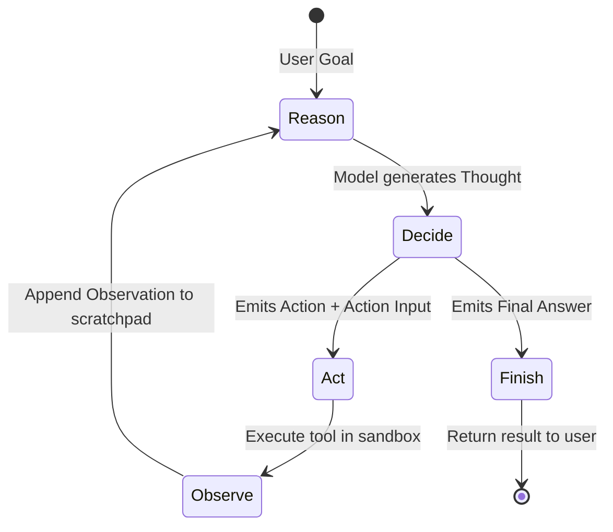

# Day 2 — The ReAct Reasoning Engine from Scratch

**Focus:** Building the core **ReAct (Reason + Act)** state machine loop from first principles in pure Python — without LangChain, LlamaIndex, or any third-party agent framework.

Today, you will write the beating heart of DevSentry: the engine that allows an LLM to "think" before it acts, execute actions, observe environment feedback, and iterate until the task is complete.

---

## Concept Primer

### 1. Python Primer for Beginners: What You Need Today

Since Python might be new to you, here are the 4 language concepts you will use today:

#### A. Dataclasses / Pydantic Models (Typed Data Containers)
In Java, you write a class with fields, getters, setters, or a Java Record. In modern Python, we use **Pydantic `BaseModel`**:
```python
from pydantic import BaseModel


class AgentAction(BaseModel):
    tool: str  # The name of the tool to call (e.g. "read_file")
    tool_input: str  # The argument for the tool (e.g. "src/main.py")
    log: str  # The raw thought/reasoning leading to this action
```
Pydantic automatically validates types at runtime and gives you JSON serialization for free.

#### B. String Parsing with Regular Expressions (`re`)
The LLM outputs plain text formatted according to instructions. To extract the tool name and input from text like:
```text
Thought: I need to inspect the file.
Action: read_file
Action Input: main.py
```
We use Python's built-in `re` module:
```python
import re

match = re.search(r"Action:\s*(.*?)\nAction Input:\s*(.*)", text, re.DOTALL)
if match:
    tool_name = match.group(1).strip()
    tool_input = match.group(2).strip()
```

#### C. Optional Types & Union (`|`)
In Python 3.10+, `AgentAction | AgentFinish` means the function can return either an `AgentAction` (continue loop) OR an `AgentFinish` (task is done). `str | None` is the Python equivalent of Java's `Optional<String>`.

---

### 2. The ReAct Architecture (Yao et al., 2022)

Most people think of LLMs as conversational chatbots: you send a prompt, they send an answer.
An **Autonomous Agent** is different. An agent executes a **Cyclic Finite State Machine (FSM)**:



1. **Thought:** The model decomposes the current problem, inspects what it knows so far, and plans its immediate next step.
2. **Action:** The model names the specific tool it wants to invoke.
3. **Action Input:** The model supplies the exact parameters for that tool.
4. **Observation:** Our Python code intercepts the Action, executes the tool, and feeds the output back into the prompt under `Observation:`.
5. **Loop or Terminate:** The model receives the observation. If more work is required, it generates another `Thought:`. If the goal is reached, it outputs `Final Answer:`.

### 3. Why Not Just Use LangChain or CrewAI?

Using an off-the-shelf framework hides how agent state machines actually operate. In high-stakes technical interviews:
- You cannot explain how parsing errors, hallucinated tool names, or token context blowups are recovered.
- Frameworks add layers of overhead, undocumented prompt modifications, and dependency conflicts.
- **Writing ReAct from scratch proves you understand the fundamental mechanics of AI agents.**

---

## Official Reference Links

- [ReAct: Synergizing Reasoning and Acting in Language Models (Yao et al., 2022 Paper)](https://arxiv.org/abs/2210.03629)
- [Python `re` Regular Expression HOWTO](https://docs.python.org/3/howto/regex.html)
- [Pydantic V2 Models Documentation](https://docs.pydantic.dev/latest/concepts/models/)

---

## Hands-on Exercise

Today you will build 3 files:
1. `src/agent/models.py` — The core domain models (`AgentAction`, `AgentFinish`, `AgentStep`).
2. `src/agent/prompts.py` — The system prompt instructing the model how to reason and act.
3. `src/agent/parser.py` — The output parser extracting actions or final answers from model text.
4. `src/agent/engine.py` — The cyclic execution loop coordinating reasoning and tool invocation.

---

### Step 1: Define Domain Models (`src/agent/models.py`)

Create `src/agent/models.py`:

```python
"""Domain models for agent actions, observations, and termination states."""

from pydantic import BaseModel, Field


class AgentAction(BaseModel):
    """An action the agent decided to execute."""

    tool: str = Field(description="Name of the tool to execute")
    tool_input: str = Field(description="Input argument passed to the tool")
    thought: str = Field(description="The reasoning trace leading to this action")


class AgentFinish(BaseModel):
    """The final state when the agent has completed its task."""

    final_answer: str = Field(description="The completed response for the user")
    thought: str = Field(description="Final reasoning trace")


class AgentStep(BaseModel):
    """A completed execution step containing action and resulting observation."""

    action: AgentAction
    observation: str = Field(description="Tool output returned back to the agent")
```

---

### Step 2: Implement the ReAct Prompt (`src/agent/prompts.py`)

Create `src/agent/prompts.py`:

```python
"""System prompts and few-shot formatting for the ReAct engine."""

REACT_SYSTEM_PROMPT = """You are DevSentry, an autonomous software engineering and DevOps diagnostic agent.
Your mission is to solve the user's task by reasoning step-by-step and calling available tools.

TOOLS AVAILABLE:
{tools_description}

FORMAT INSTRUCTIONS:
To solve the task, you MUST use the following format:

Question: the input task you must solve
Thought: you should always think about what to do next
Action: the action to take, should be one of [{tool_names}]
Action Input: the input to the action
Observation: the result of the action
... (this Thought/Action/Action Input/Observation can repeat N times)
Thought: I now know the final answer
Final Answer: the final answer to the original input question

RULES:
1. Always begin with a "Thought:".
2. Only output ONE Action and ONE Action Input per step.
3. After "Action Input:", STOP generating and wait for the Observation.
4. When you have enough information to solve the task, output "Final Answer:".
"""


def build_scratchpad(intermediate_steps: list) -> str:
    """Format previous actions and observations into the prompt scratchpad."""
    scratchpad = ""
    for step in intermediate_steps:
        scratchpad += f"Thought: {step.action.thought}\n"
        scratchpad += f"Action: {step.action.tool}\n"
        scratchpad += f"Action Input: {step.action.tool_input}\n"
        scratchpad += f"Observation: {step.observation}\n"
    return scratchpad
```

---

### Step 3: Implement the Output Parser (`src/agent/parser.py`)

Create `src/agent/parser.py` with this guided TODO:

```python
"""Parser for extracting AgentAction or AgentFinish from model text."""

import re
from src.agent.models import AgentAction, AgentFinish


class ReActParsingError(Exception):
    """Raised when model response cannot be parsed into ReAct format."""

    pass


class ReActParser:
    """Parses raw LLM completion text into structured AgentAction or AgentFinish."""

    def parse(self, text: str) -> AgentAction | AgentFinish:
        """Parse raw model output.

        # TODO: Implement the parsing logic:
        # 1. Check if "Final Answer:" is in text. If so, extract the text after it
        #    and return AgentFinish(final_answer=..., thought=...).
        # 2. Otherwise, use regex to find:
        #    - Thought: (everything before Action:)
        #    - Action: (the tool name)
        #    - Action Input: (the tool argument)
        # 3. If matching succeeds, return AgentAction(tool=..., tool_input=..., thought=...).
        # 4. If matching fails, raise ReActParsingError with descriptive message.
        """
        raise NotImplementedError("Implement ReActParser.parse")
```

<details>
<summary>👉 Click to reveal Answer Key for `src/agent/parser.py`</summary>

```python
"""Parser for extracting AgentAction or AgentFinish from model text."""

import re
from src.agent.models import AgentAction, AgentFinish


class ReActParsingError(Exception):
    """Raised when model response cannot be parsed into ReAct format."""

    pass


class ReActParser:
    """Parses raw LLM completion text into structured AgentAction or AgentFinish."""

    def parse(self, text: str) -> AgentAction | AgentFinish:
        if "Final Answer:" in text:
            parts = text.split("Final Answer:", 1)
            thought = parts[0].replace("Thought:", "").strip()
            final_answer = parts[1].strip()
            return AgentFinish(final_answer=final_answer, thought=thought)

        pattern = r"Thought:\s*(.*?)\s*Action:\s*([a-zA-Z0-9_\-]+)\s*Action Input:\s*(.*)"
        match = re.search(pattern, text, re.DOTALL)
        if match:
            thought = match.group(1).strip()
            tool = match.group(2).strip()
            tool_input = match.group(3).strip()
            return AgentAction(tool=tool, tool_input=tool_input, thought=thought)

        # Fallback for outputs omitting explicit 'Thought:' prefix
        fallback_pattern = r"Action:\s*([a-zA-Z0-9_\-]+)\s*Action Input:\s*(.*)"
        match_fallback = re.search(fallback_pattern, text, re.DOTALL)
        if match_fallback:
            tool = match_fallback.group(1).strip()
            tool_input = match_fallback.group(2).strip()
            return AgentAction(tool=tool, tool_input=tool_input, thought="")

        raise ReActParsingError(
            f"Could not parse LLM output into ReAct format. Output was:\n{text}"
        )
```
</details>

---

### Step 4: Implement the ReAct Engine Loop (`src/agent/engine.py`)

Create `src/agent/engine.py` with this guided TODO:

```python
"""Core ReAct execution engine."""

from typing import Callable
from src.agent.models import AgentAction, AgentFinish, AgentStep
from src.agent.parser import ReActParser
from src.agent.prompts import REACT_SYSTEM_PROMPT, build_scratchpad
from src.llm.client import LLMClient


class ReActEngine:
    """Orchestrates the ReAct reasoning and execution loop."""

    def __init__(
        self,
        llm_client: LLMClient,
        tools: dict[str, Callable[[str], str]],
        max_iterations: int = 5,
    ):
        self.llm = llm_client
        self.tools = tools
        self.max_iterations = max_iterations
        self.parser = ReActParser()

    def run(self, question: str) -> str:
        """Run the ReAct loop until completion or max iterations.

        # TODO: Implement the loop:
        # 1. Track `intermediate_steps: list[AgentStep] = []`
        # 2. Loop from iteration 0 to self.max_iterations:
        #    a. Format prompt with question, tools, and build_scratchpad(intermediate_steps)
        #    b. Call self.llm.generate(...) with stop sequence ["Observation:"]
        #    c. Parse output using self.parser.parse(output)
        #    d. If result is AgentFinish: return result.final_answer
        #    e. If result is AgentAction:
        #       - Execute tool from self.tools[result.tool](result.tool_input)
        #       - Append AgentStep(action=result, observation=tool_output)
        # 3. If max iterations exceeded, return an error message.
        """
        raise NotImplementedError("Implement ReActEngine.run")
```

<details>
<summary>👉 Click to reveal Answer Key for `src/agent/engine.py`</summary>

```python
"""Core ReAct execution engine."""

from typing import Callable
from src.agent.models import AgentAction, AgentFinish, AgentStep
from src.agent.parser import ReActParser
from src.agent.prompts import REACT_SYSTEM_PROMPT, build_scratchpad
from src.llm.client import LLMClient


class ReActEngine:
    """Orchestrates the ReAct reasoning and execution loop."""

    def __init__(
        self,
        llm_client: LLMClient,
        tools: dict[str, Callable[[str], str]],
        max_iterations: int = 5,
    ):
        self.llm = llm_client
        self.tools = tools
        self.max_iterations = max_iterations
        self.parser = ReActParser()

    def run(self, question: str) -> str:
        intermediate_steps: list[AgentStep] = []
        tool_names = ", ".join(self.tools.keys())
        tools_description = "\n".join([f"- {name}: callable function" for name in self.tools])

        for _ in range(self.max_iterations):
            scratchpad = build_scratchpad(intermediate_steps)
            prompt = (
                f"{REACT_SYSTEM_PROMPT.format(tools_description=tools_description, tool_names=tool_names)}\n\n"
                f"Question: {question}\n"
                f"{scratchpad}"
            )

            messages = [{"role": "user", "content": prompt}]
            raw_response = self.llm.generate(messages, stop=["Observation:"])

            parsed = self.parser.parse(raw_response)

            if isinstance(parsed, AgentFinish):
                return parsed.final_answer

            if isinstance(parsed, AgentAction):
                tool_func = self.tools.get(parsed.tool)
                if tool_func:
                    try:
                        observation = str(tool_func(parsed.tool_input))
                    except Exception as e:
                        observation = f"Error executing {parsed.tool}: {e}"
                else:
                    observation = f"Error: Tool '{parsed.tool}' not found in [{tool_names}]."

                intermediate_steps.append(AgentStep(action=parsed, observation=observation))

        return f"Agent failed to reach final answer within {self.max_iterations} iterations."
```
</details>

---

## Checkpoint

To verify your Day 2 implementation:
1. Create `tests/test_react_engine.py` with mock tools (e.g. a simple string reverser or calculator).
2. Run pytest:
   ```powershell
   pytest -v tests/test_react_engine.py
   ```
3. Run an end-to-end question with the CLI:
   ```powershell
   python -m src.cli "What is the result of reversing 'Hello World'?"
   ```

---

## Senior Interview Angle

### Q: "How does the ReAct pattern prevent hallucination compared to standard Chain-of-Thought (CoT)?"
**Senior Answer:**
> *"In standard Chain-of-Thought prompting, the LLM generates reasoning steps purely based on internal parametric memory. If an early reasoning step hallucinates an incorrect fact, all downstream steps amplify that error without any reality grounding.
> 
> ReAct introduces an interactive feedback loop between reasoning and environmental grounding:
> 1. Reasoning guides the search for external evidence (action selection).
> 2. Real-world observations inject factual, non-parametric truth back into the prompt context.
> 3. Downstream reasoning steps adjust their trajectory based on actual observations rather than speculation.
> 
> This eliminates hallucination in domains requiring external facts, dynamic state (code execution, database reads), or precise calculation."*

---

## Ready to Merge?

When your tests pass and linter is clean:
```powershell
git checkout -b feat/day2-react-engine
git add src/ tests/ docs/
git commit -m "feat(agent): implement ReAct loop, parser, and state machine from scratch"
git push -u origin feat/day2-react-engine
```
Open PR #2 on GitHub and merge into `main`!
